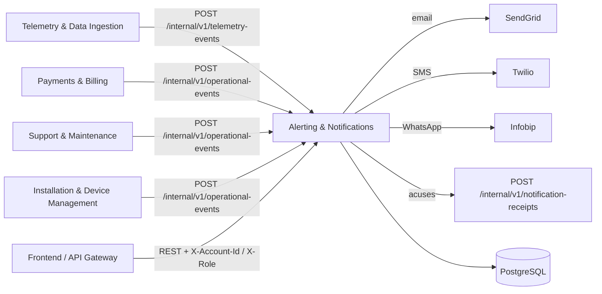
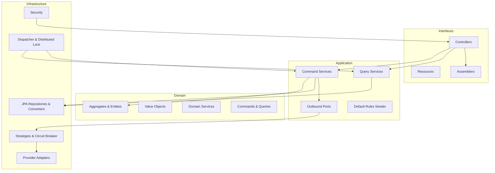
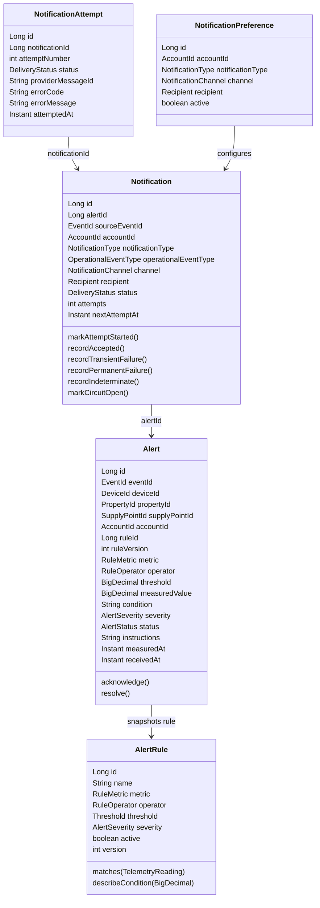
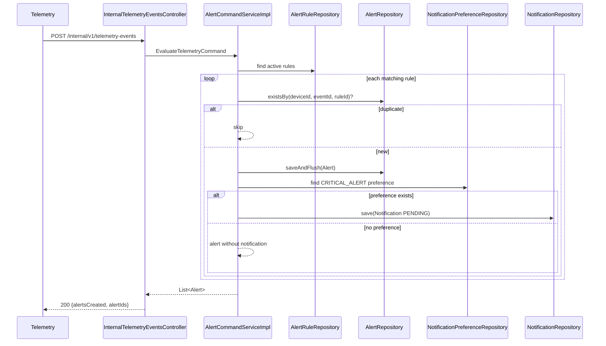
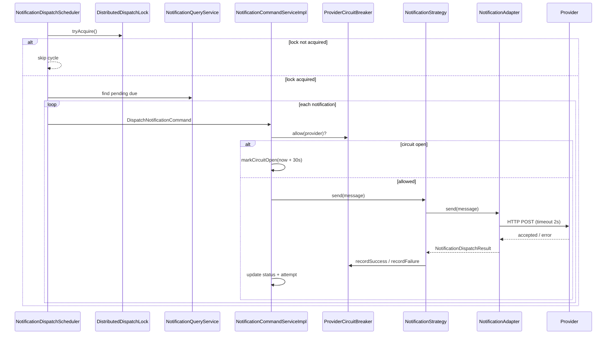
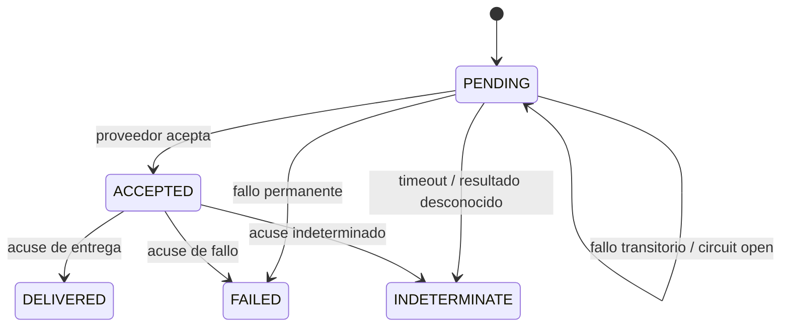
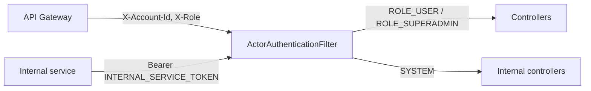

# Arquitectura — SmartGN Alerting & Notifications

## 1. Contexto

El servicio consume eventos normalizados de telemetría y eventos operativos, evalúa reglas, persiste alertas y encola notificaciones. Un dispatcher independiente entrega por proveedores externos y registra el resultado.

## 2. Capas

## 3. Modelo de dominio

## 4. Evaluación de telemetría

La alerta y la notificación se guardan en la misma transacción. La transacción se cierra antes de que el dispatcher intente la entrega.

## 5. Despacho, reintentos y circuit breaker

Estados de entrega:

## 6. Persistencia

| Tabla | Propósito | Restricciones clave |
| --- | --- | --- |
| `alert_rules` | Reglas de evaluación versionadas | `name` único |
| `alerts` | Snapshot de la alerta | `(device_id, event_id, rule_id)` único |
| `notification_preferences` | Canal y destinatario por cuenta/tipo | `(account_id, notification_type)` único |
| `notifications` | Outbox y estado de entrega | `(alert_id, channel, recipient)` y `(source_event_id, channel, recipient)` únicos |
| `notification_attempts` | Bitácora append-only de intentos/acuses | `(notification_id, attempt_number)` único |

El nombramiento físico es `snake_case` mediante `SnakeCasePhysicalNamingStrategy`. La auditoría usa `@CreatedDate` y `@LastModifiedDate`.

## 7. Seguridad

- `smartgn.security.enabled=false` por defecto para desarrollo local.
- Con seguridad activa, las rutas `/api/v1/**` requieren `X-Account-Id`; `SUPERADMIN` puede consultar todas las cuentas.
- Las rutas `/internal/**` requieren `Authorization: Bearer <INTERNAL_SERVICE_TOKEN>`.
- El gateway debe eliminar las cabeceras de identidad enviadas por el cliente.
- No se valida JWT dentro del servicio; la confianza se delega al gateway.

## 8. Decisiones y límites

- El circuit breaker es en memoria y por instancia. Con varias réplicas cada una mantiene su propio estado; el lock distribuido evita despachos simultáneos, pero no comparte el estado del circuito.
- El dispatcher realiza la llamada HTTP dentro de la transacción de actualización. Para volúmenes altos se recomienda separar “claim” y “send” en transacciones distintas.
- SmartGN no opera válvulas remotamente. `VALVE_STATE` solo genera una alerta informativa.
- Las reglas por defecto son datos de arranque, no migraciones; se pueden desactivar con `smartgn.alerting.seed-default-rules=false`.
